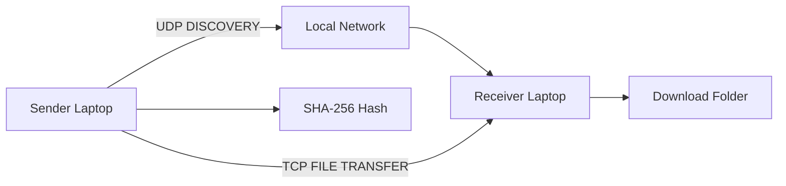

# FastDrop

FastDrop is a local-network desktop application for transferring files directly between laptops on the same Wi‑Fi network or mobile hotspot. It uses real UDP discovery, real TCP file transfer, a short pairing code, and SHA-256 integrity verification without any cloud service or central server.

## Project overview

This project demonstrates core computer network concepts in a practical desktop app:

- UDP device discovery on the local network
- TCP connection-oriented file transfer
- JSON-based control protocol messages
- One-time 6-digit pairing code authorization
- File chunking for large transfers
- SHA-256 verification before reporting success
- A minimal PySide6 GUI that remains responsive while transfers run

## Architecture



The package is organized as follows:

- fastdrop/main.py — application entry point
- fastdrop/ui/ — PySide6 windows and controls
- fastdrop/networking/ — discovery, protocol, sender, receiver
- fastdrop/security/ — pairing validation and hashing
- fastdrop/models/ — data classes for peers and transfer state
- fastdrop/utils/ — network and file helper functions
- tests/ — local verification tests

## How device discovery works

Each FastDrop instance broadcasts a UDP discovery packet on a known port. The packet includes:

```json
{
  "type": "DISCOVERY",
  "device_id": "uuid-value",
  "device_name": "Phani's Laptop",
  "port": 50002,
  "status": "available"
}
```

A peer receiving the packet responds with a `DISCOVERY_RESPONSE` containing its local IP and TCP port. The sender builds a device list from those responses and shows the user a list of discoverable peers. Discovery is periodic and lightweight.

## How UDP is used

UDP is used for discovery only. It is suitable because the sender is simply locating nearby devices, not exchanging large files. The discovery service listens on a fixed UDP port and broadcasts to the local subnet using the broadcast address.

## How TCP is used

TCP is used for the actual file transfer and control flow. It provides ordered, reliable delivery for the file stream and metadata exchange. The application does not implement a custom reliability layer over TCP because the transport already provides one.

## Pairing-code protocol

The pairing code is a six-digit random number generated by Python's `secrets` module and expires after about 60 seconds. The sender displays the code and tells it to the receiver verbally. The receiver enters it into the UI before the transfer proceeds.

The logical flow is:

1. Sender sends `TRANSFER_REQUEST` with file metadata.
2. Receiver sends `PAIRING_CHALLENGE`.
3. Receiver user confirms the code and sends `PAIRING_RESPONSE` containing the six-digit code.
4. Sender validates the code and checks expiry and attempts.
5. Sender sends `PAIRING_VERIFIED` if valid.
6. Receiver sends `TRANSFER_ACCEPT` or `TRANSFER_REJECT`.
7. Sender starts sending file chunks.

The pairing code is never broadcast in plaintext as part of discovery messages.

## File-transfer protocol

The file is sent in chunks, typically 64 KB at a time, using the TCP connection. Messages are JSON-encoded control messages and the file data is streamed as raw bytes.

Control message types include:

- DISCOVERY
- DISCOVERY_RESPONSE
- TRANSFER_REQUEST
- PAIRING_CHALLENGE
- PAIRING_RESPONSE
- TRANSFER_ACCEPT
- TRANSFER_REJECT
- FILE_INFO
- FILE_DATA
- TRANSFER_COMPLETE
- CHECKSUM
- ERROR

The receiver writes each file chunk directly to disk and does not load the whole file into memory.

## SHA-256 integrity verification

Before transfer, the sender calculates the file SHA-256 incrementally. The hash is sent as metadata. The receiver calculates its own hash while writing the file and compares it against the expected hash. A transfer is only reported as successful if both hashes match.

## Installation instructions

1. Install 64-bit Python 3.11 or newer on Windows, macOS, or Linux.
2. Clone the GitHub repository or download and unzip its source archive. For Git:

```bash
git clone https://github.com/phaneendra-simhadri/FastDrop.git
cd FastDrop
```

3. Open a terminal in the project directory.
4. Create and activate a virtual environment:

Windows PowerShell:

```powershell
py -3 -m venv .venv
.\.venv\Scripts\Activate.ps1
```

macOS / Linux:

```bash
python3 -m venv .venv
source .venv/bin/activate
```

5. Install dependencies (internet is needed for this first install):

```bash
python -m pip install -r requirements.txt
```

Repeat these steps on both laptops. No server, account, or internet connection is needed after dependencies are installed.

## How to run the application

From the project root:

```bash
python main.py
```

The app opens a main screen with Send File and Receive File actions.

## How to test using two laptops connected to the same hotspot

1. Connect both laptops to the same mobile hotspot or Wi‑Fi network (disable client/AP isolation if possible).
2. Launch FastDrop on **both** laptops (`python main.py`).
3. On the **receiver**, click **Receive File** (or wait — the window opens automatically when a sender connects).
4. On the **sender**, click **Send File**, choose a file, wait for the receiver to appear in the list, select it, and click **Send**.
5. The sender shows a **6-digit pairing code** — read it aloud to the receiver.
6. On the receiver, type the code and click **Verify Code**, then click **Accept File**.
7. Watch the progress bar; the file is saved under `Downloads/FastDrop` (or your configured folder).
8. Both sides confirm success only after **SHA-256** hashes match.

The receiver asks for the pairing code and a separate **Accept File** click before writing the file. Use **Reject** to decline an unexpected request. Either laptop can cancel an active transfer; incomplete files are removed and the transfer must be started again. If Wi-Fi/hotspot connectivity drops, FastDrop times out or reports the lost connection, removes any partial download, and can be retried after both laptops reconnect. Transfers do not resume automatically.

On Windows, allow Python/FastDrop through the private-network firewall prompt on both laptops. If discovery still fails, permit inbound UDP port 50001 and inbound TCP port 50002, or set matching `FASTDROP_DISCOVERY_PORT` / `FASTDROP_TCP_PORT` values before launching. On macOS/Linux, allow the app's incoming local-network connections if the firewall asks. The hotspot must allow client-to-client traffic; guest networks and some hotspots block it.

> If the network uses client isolation or AP isolation, peer-to-peer discovery and direct TCP between laptops may not work. FastDrop cannot bypass that restriction.

## Security design (for review / viva)

FastDrop is a **local-network teaching project**, not a production file-sharing product. These controls are implemented:

| Control | Purpose |
|---------|---------|
| **6-digit pairing code** (`secrets`) | Only someone who sees the sender screen can authorize the transfer |
| **3 attempt limit + 60s expiry** | Slows guessing; codes are compared with timing-safe `compare_digest` |
| **SHA-256 end-to-end check** | Detects corrupted or tampered file data |
| **Filename sanitization + path confinement** | Blocks `../` style names; files stay under the receive folder |
| **Bounded protocol messages (64 KB)** | Prevents memory exhaustion from huge JSON headers |
| **Max file size (default 2 GB, env `FASTDROP_MAX_FILE_BYTES`)** | Reduces disk-fill abuse on the receiver |
| **Chunk size cap (64 KB)** | Matches sender; rejects oversized chunk headers |
| **Discovery only from private IPs** | Ignores discovery packets from non-local addresses |
| **TCP port range validation** | Rejects invalid peer ports |

**Honest limitations** (appropriate to mention in class): traffic is **not encrypted** (plain TCP on LAN), there is **no user account system**, and anyone on the same open Wi‑Fi could *attempt* a connection—but they still need the **live pairing code** and receiver **Accept** click. For a stricter deployment you would add TLS and mutual authentication.

## Known limitations

- Works on local networks where devices can talk directly to each other.
- Requires the Wi‑Fi/hotspot not to isolate client-to-client traffic.
- Plain TCP on the LAN (no TLS)—by design for this CN lab scope.
- Basic local GUI flow is intentionally simple and focused on reliability.

## Troubleshooting

- No devices discovered: confirm both devices are on the same Wi‑Fi or hotspot and not behind client isolation.
- Connection timeout: ensure the target IP and port are reachable and the receiver app is running.
- Invalid pairing code: verify the number and check that it has not expired.
- Permission denied: choose a writable directory or adjust file permissions.
- Disk full: free space in the destination directory.
- Port already in use: choose a different port or stop the conflicting process.
- A laptop disappeared after a network change: wait several seconds for the peer list to refresh, reconnect both laptops to the same hotspot, and retry.
- Transfer interrupted: reconnect to the same network and start the transfer again; partial downloads are deleted rather than presented as complete files.

## Network architecture diagram

```text
+-------------------+        UDP Broadcast        +-------------------+
| Sender Laptop     | -------------------------> | Receiver Laptop    |
| FastDrop Sender   |                            | FastDrop Receiver |
+-------------------+                            +-------------------+
         |                                             |
         |--------------- TCP connection --------------|
         |                                             |
         v                                             v
+-------------------+       File chunks + SHA-256     +-------------------+
| Local file        | --------------------------------> | Download folder   |
| selected by user  |                                    | on receiver       |
+-------------------+                                    +-------------------+
```
